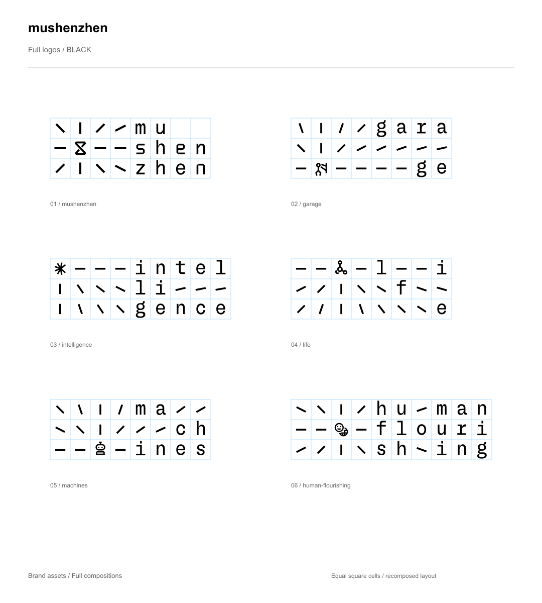
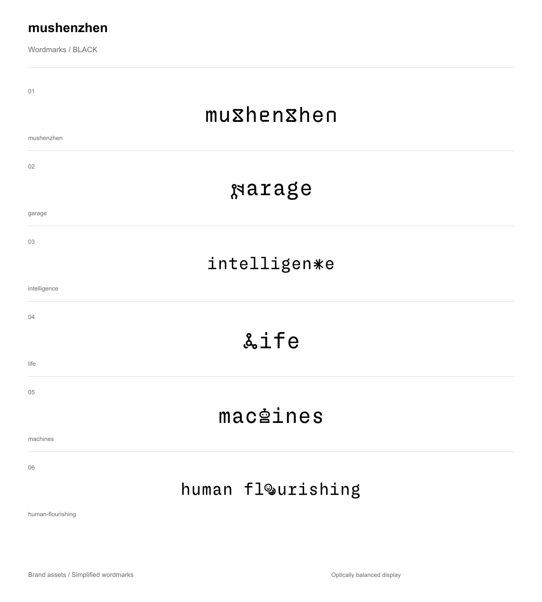
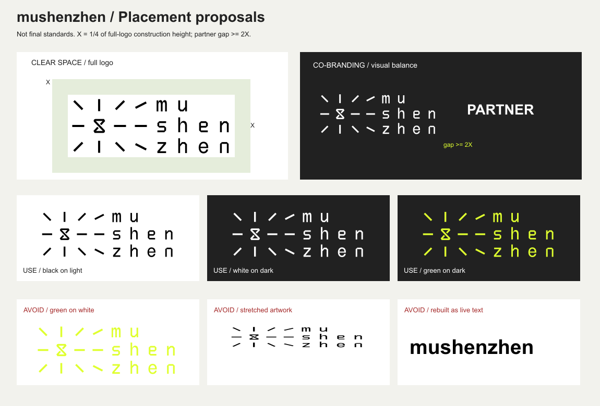
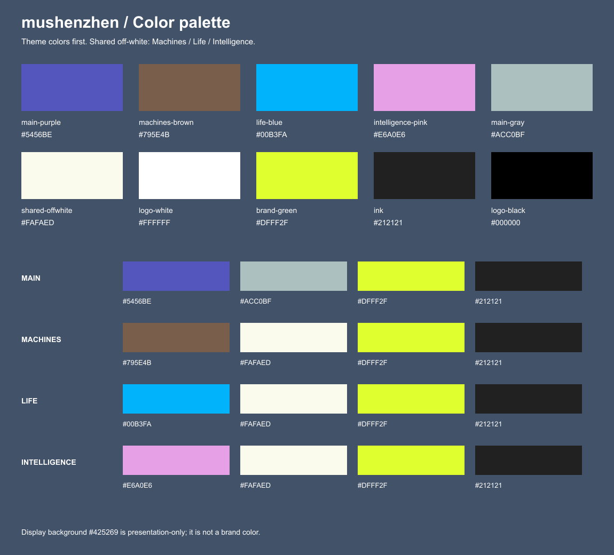
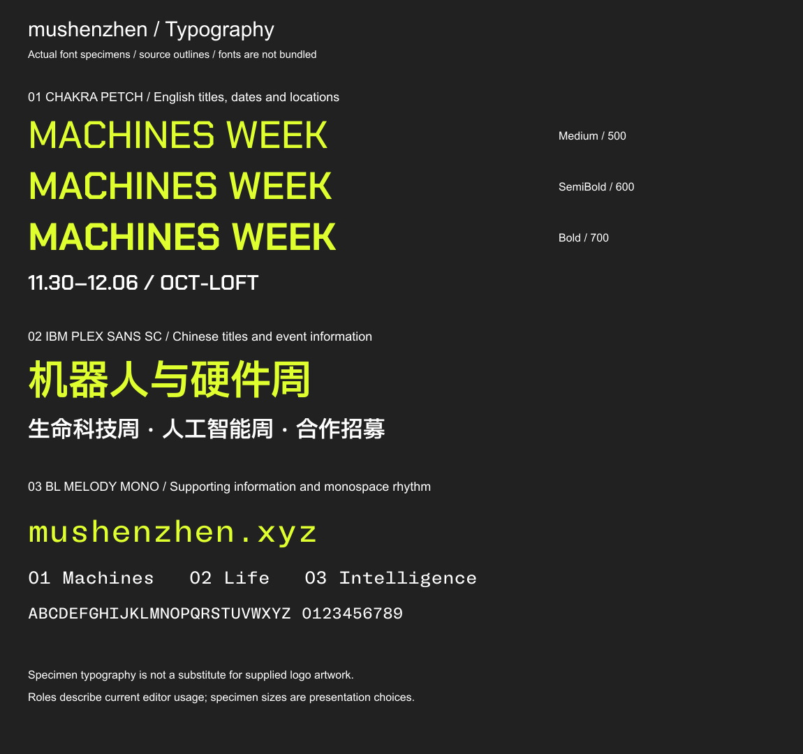
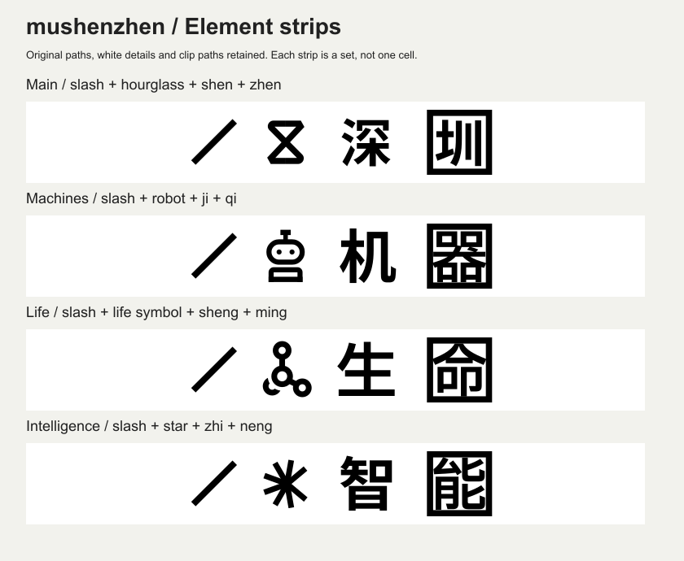

# mushenzhen 品牌使用指南

**mushenzhen · a city for makers**

## 品牌定位与叙事

mushenzhen 是一座以整个深圳为实验田野的 Maker City。智能正在从屏幕进入现实，创造者在深圳的硬件、制造与供应链环境中相遇，把想法经过打样、测试和修改，做成可用产品。

品牌身份是“我们是连接”：让深圳与全球人才之间已有的吸引显形。网格与标线对应试验田，独立又能组合的单元对应合作关系；设计应呈现行动与成果，而不只堆叠技术符号。

三条路径是 **Garage**（从想法到产品）、**Frontier Fusion**（跨领域主题周）、**Human Flourishing**（为什么而 Build？为谁而 Build？）。正文名称统一为 mushenzhen；slogan 为 a city for makers。

[完整概念、叙事与品牌语言](BRAND-STORY.md) · [商用与署名要求](USAGE.md)

视觉元素和模板允许商用，使用时必须提到 **mushenzhen**。例如：“视觉素材来源：mushenzhen”。

### 完整版 Logo · 已确认的方格标准版

按最新要求，完整版改为每格一个字母或符号，每格 50 × 50 单位、三排；保留字形路径，调整元素间距与位置。以下版本不含辅助线，展示图中的浅蓝网格不随 Logo 导出。

| Logo | 黑色 | 白色 | 荧光绿 |
|---|---|---|---|
| mushenzhen | [black](assets/logos/full/mushenzhen-full-black.svg) | [white](assets/logos/full/mushenzhen-full-white.svg) | [green](assets/logos/full/mushenzhen-full-green.svg) |
| garage | [black](assets/logos/full/garage-full-black.svg) | [white](assets/logos/full/garage-full-white.svg) | [green](assets/logos/full/garage-full-green.svg) |
| intelligence | [black](assets/logos/full/intelligence-full-black.svg) | [white](assets/logos/full/intelligence-full-white.svg) | [green](assets/logos/full/intelligence-full-green.svg) |
| life | [black](assets/logos/full/life-full-black.svg) | [white](assets/logos/full/life-full-white.svg) | [green](assets/logos/full/life-full-green.svg) |
| machines | [black](assets/logos/full/machines-full-black.svg) | [white](assets/logos/full/machines-full-white.svg) | [green](assets/logos/full/machines-full-green.svg) |
| human-flourishing | [black](assets/logos/full/human-flourishing-full-black.svg) | [white](assets/logos/full/human-flourishing-full-white.svg) | [green](assets/logos/full/human-flourishing-full-green.svg) |

**精简版 0.1 · 2026-11-03 · 品牌指南**

适用于媒体、合作方、设计师、运营人员，以及他们使用的 Agent。先选对文件，再开始设计。品牌名称在正文中写作 **mushenzhen**；Logo 内的字形和换行使用现成矢量，不重新打字模拟。

这份指南区分三种信息：**已确认**是用户明确的方向；**定稿提取**是现有作品中的事实；**使用建议**是用于排版的推荐做法，不是所有媒介下的强制阈值。公开使用许可另行明确，本文不是授权协议。

## 01 / 先选对 Logo

### Logo 展示页

以下尺寸仅用于展示中的视觉平衡，不是 Logo 的强制使用尺寸。简化版保持原构成；完整版展示采用下方说明的方格重排版。

| 形式 | 黑色 | 白色 | 荧光绿 |
|---|---|---|---|
| 完整版 | [查看](examples/logo-full-black.png) | [查看](examples/logo-full-white.png) | [查看](examples/logo-full-green.png) |
| 简化版 | [查看](examples/logo-simple-black.png) | [查看](examples/logo-simple-white.png) | [查看](examples/logo-simple-green.png) |

我们准备了六组 Logo 的完整版与简化版，每个版本有黑、白、荧光绿三个透明底 SVG。具体文件见 [素材入口](README.md) 与 [机器可读索引](assets.json)。

- **完整版**包含展开的短线、符号和分行文字，适合有足够空间的封面、活动视觉及品牌介绍。
- **简化版**以横向字标为主，适合页眉、合作方 Logo 栏、较小或较扁的空间。
- Garage、Intelligence、Life、Machines、Human Flourishing 按文件中的名称归类；这里不擅自规定其组织层级，也不把主题 Logo 当成 mushenzhen 主 Logo 的替代品。

**已确认：**完整版使用等大方格，每格一个字母或完整符号，统一三排；每格 50 × 50 源文件单位，按名称分别为 8、9、10 列。对外使用时整体等比缩放，不单独改变格宽、格高或重排单元。Logo 提供黑、白、核心绿版本；核心绿为 `#DFFF2F`。

**使用建议：**使用完整矢量，等比缩放，不改变字形、字间距、符号位置、内部线条角度或组合关系。颜色变化用已提供版本，不为 Logo 添加渐变、描边、投影或纹理；装饰图形的创作自由另见第 06 节。

## 02 / 黑、白、绿分别怎样用

| 版本 | 建议背景 | 选择原则 |
|---|---|---|
| 黑色 `#000000` | 白、米白、浅色、足够明亮的荧光绿 | 信息清晰，适合正文附近和合作方清单 |
| 白色 `#FFFFFF` | 深色或较暗的平整区域 | 背景复杂时，先给 Logo 留出干净区域 |
| 荧光绿 `#DFFF2F` | 优先搭配品牌深色 `#212121` | 适合强调品牌，但不是所有版面都必须用绿 |

避免绿色 Logo 放在白底、白色 Logo 放在亮色底，或让照片中的细节穿过 Logo。此处是识别性建议，不等同于为 Logo 宣称文字无障碍合规。照片上可以使用 Logo，但应先选择干净、有足够对比的区域，必要时加一块纯色承托。

`#000000` 是黑色 Logo 的纯黑；`#212121` 是定稿海报的深色。两者用途不同，不自动互相替换。透明底不是白底：白色 SVG 在白色查看器里会看不见，应置于深色背景检查。

## 03 / 留白、尺寸与合作方并排

以下为本版已通过审核的**使用建议**，用于指导排版，不是所有媒介下的强制阈值。

**留白。**完整版以三排构成网格总高度 H＝3 格为基准，建议从网格外边界向外留出至少 H/4（¾ 格）；简化版以可见字形高度 H 为基准，建议四周至少 H/2。图片、文字、装饰符号和裁切边缘都不进入这一区域。

**小尺寸。**已做黑底/浅底版本检查和屏幕尺寸对照。复杂版缩小时，细线和中心小符号比文字更早变得难辨；简化版更适合狭长的小空间。下面是保守的屏幕使用起点，仍需在实际终端和输出尺寸检查。

| 文件类型 | 建议起始最小宽度（完整版按构成网格） |
|---|---:|
| 完整版：mushenzhen / Garage / Life / Machines（8 列） | 200 CSS px |
| 完整版：Intelligence（9 列） | 225 CSS px |
| 完整版：Human Flourishing（10 列） | 250 CSS px |
| mushenzhen / Garage / Life / Machines 简化版 | 160 CSS px |
| Intelligence 简化版 | 200 CSS px |
| Human Flourishing 简化版 | 240 CSS px |

这些数值不作为印刷毫米值或手机实际可读性的保证。空间不足时换简化版或调整版面，不挤压 Logo。请按原尺寸查看 [完整版尺寸对照](examples/size-study.png) 和 [简化版尺寸对照](examples/wordmark-sizes.png)，缩放预览会改变实际测试尺寸。

**联合署名。**建议先取得视觉重量平衡，再以居中或基线对齐；不要强行把不同形状的 Logo 拉成同宽。同等合作关系下不预设“对方必须更小”。两个 Logo 之间至少保留双方建议留白的总和；主次关系明确的场合，再按活动署名约定安排顺序和大小。示意图中的 PARTNER 只是占位文字。

## 04 / 完整色板：核心色与主题色

| 名称 | HEX | RGB | 依据与用途 |
|---|---|---|---|
| 主视觉紫 | `#5456BE` | 84, 86, 190 | **定稿提取**；主视觉主题色 |
| 机器人棕 | `#795E4B` | 121, 94, 75 | **定稿提取**；机器人与硬件主题 |
| 生命蓝 | `#00B3FA` | 0, 179, 250 | **定稿提取**；生命主题 |
| 智能粉 | `#E6A0E6` | 230, 160, 230 | **定稿提取**；人工智能主题 |
| 主视觉灰 | `#ACC0BF` | 172, 192, 191 | **定稿提取**；主视觉辅助色 |
| 主题共用米白 | `#FAFAED` | 250, 250, 237 | **用户确认**；Machines、Life、Intelligence 共用，与原 Life 米白一致 |
| 白 | `#FFFFFF` | 255, 255, 255 | **已确认白色版本的实现**；Logo；元素中的白色细节原样保留 |
| 核心荧光绿 | `#DFFF2F` | 223, 255, 47 | **已确认**；官方默认识别色 |
| 品牌深色 | `#212121` | 33, 33, 33 | **定稿提取**；四张海报共同底色/前景色 |
| Logo 纯黑 | `#000000` | 0, 0, 0 | **已确认黑色版本的实现**；Logo，不替代海报深色 |

色板展示顺序为主题色在前、荧光绿和深色在后；展示背景 `#425269` 仅用于衬托色样，不属于品牌色。三个主题共用米白 `#FAFAED`，Logo 白仍为 `#FFFFFF`。

配色角色名称是本次为方便检索而整理的标签。主题色值取自当前编辑器四张 SVG 定稿模板的矢量填色，不从照片的像素颜色反推品牌色。

**默认组合建议：**先选择一套主题色，以深色/浅色建立信息层级，再用荧光绿和主题色强调。不要默认把全部色板同时放进一张图，也不硬性指定颜色面积比例。

**创作自由已确认：**合作方可以使用自己的配色，不要求所有作品以荧光绿为主；保留视觉构成特征和准确的品牌署名。对外正式 Logo 先选黑、白、绿三版；其他 Logo 改色不因装饰配色自由而自动获准。

这里只提供屏幕 HEX/RGB。CMYK 与专色需结合印刷材质、设备和打样确定；不能把屏幕荧光绿随意换算后写成已确认印刷标准。

## 05 / 字体与信息层级

当前编辑器使用以下字体：

| 字体 | 定稿中可观察到的用途 |
|---|---|
| Chakra Petch，Medium / SemiBold / Bold | 英文标题、日期、地点等结构性信息 |
| IBM Plex Sans SC，SemiBold | 中文标题与活动信息 |
| BL Melody Mono，Regular | 辅助英文、等宽信息与部分视觉字形语言 |

这是现有制作文件的字体记录，**不是新增的全球排版强制标准**。各 Logo 已转为矢量路径，使用 Logo 不需要安装字体，也不能用这些字体重新打字取代 Logo。

本包不分发字体。制作可编辑文字时另行确认字体取得方式；缺字体时向使用者说明，不能默默替换后声称还原定稿。

**层级建议：**首先读到活动名，再读日期/地点，最后读合作信息。用字号、分区和留白组织层级，避免每一行都同样巨大、同样醒目。中英文分别调节字距和行距，不机械套用同一数值。

## 06 / 保留辨识度，同时大胆变化

这四个 SVG 各包含一组元素，不是一个单独网格单元。不要把“深／圳”“智／能”等整组压缩进一格。带底框、白色字形或剪切路径的元素应作为完整图形处理，不能把黑白全部替换成一个颜色。

**从当前作品归纳出的构成方式：**

- **网格组织形状。**色块、图标和部分图片裁切在同一网格中关联。阶梯边缘来自网格变化，避免任意小数位置导致单元错位。
- **负空间参与造字。**大字可以由空出来的区域形成，不一定靠小符号拼字。先检查大形是否成立，再加细节。
- **底色色块与元素分层。**当前定稿使用不透明色块；元素的种类、颜色、位置和出现频率形成变化。不要为了模仿层次而自动给整个底色加透明度渐变。
- **边缘有节奏。**沿边界形成连续段落，在转角或色块交界切换元素，再逐步减少出现频率。保留安静的空格，避免随机撒满画面或用同一个字围一整圈。
- **同类元素保持尺寸。**在同一个网格尺度中，同一种斜线使用统一比例和线宽，通过颜色与出现频率调节节奏。
- **图片与几何图形互相作用。**当前作品包含有限色、高对比图片处理，以及图像上叠加像素块和符号。图片内容可以更换，优先确保主角和关键信息可辨。

**建议的延展顺序：**先确定主题和主要信息 → 选图片与大色块 → 建立网格/留白 → 选择一套符号 → 调整局部密度 → 放置准确 Logo → 缩小检查信息层级。

ClawCon 是用户认可的延展示例：它用自己的橘红、粉、奶黄和深蓝，结合主题字与斜线、色块带和高对比图片。这里借鉴的是组合方法，不随包收录它的图片、Logo 或页面。

不是每张图都必须包含负空间大字、全部符号和所有主题色。较简洁的合作方通知，也可以只用清晰的字标、网格对齐和一小段元素。

## 07 / 发布前的简短检查

- 使用的是正确主题和版本吗？Logo 有没有被拉伸、裁掉或重新打字？
- 标准绿色是否为 `#DFFF2F`？主题色是否引用准确值？
- 背景上的 Logo 能否清楚辨认？重要文字是否比装饰更容易读？
- 是否误把整组图标塞进一个格子，或丢失反白细节？
- 小尺寸下有没有糊成一团？是否更适合换简化版？
- 公开文件和其中的字体、图片是否已确认可以分发？

## 参考与适用边界

本指南借鉴品牌指南的组织方法，不照搬其他品牌的数值、文案或限制：

- [NorthAlley Guideline](https://www.dropbox.com/scl/fi/orgshu2ujnhefrczsyyru/NorthAlley-Guideline.pdf?rlkey=0v6awhu7gp8omg0b9wpdrk4g1&dl=0)：Logo 使用、联合署名、色板与应用示例的组织方式。
- [MIT Media Lab Brand Portal](https://www.media.mit.edu/posts/MLBrandPortal/)：网格体系、Logo 家族、留白与活动视觉之间的关系。
- [Adobe：制作品牌指南](https://www.adobe.com/creativecloud/business/teams/resources/how-to/brand-guide.html)：把资产和具体使用场景连接起来。

使用视觉元素与模板时须注明 mushenzhen，详见 [使用说明](USAGE.md)。本包不包含第三方字体文件或照片。
