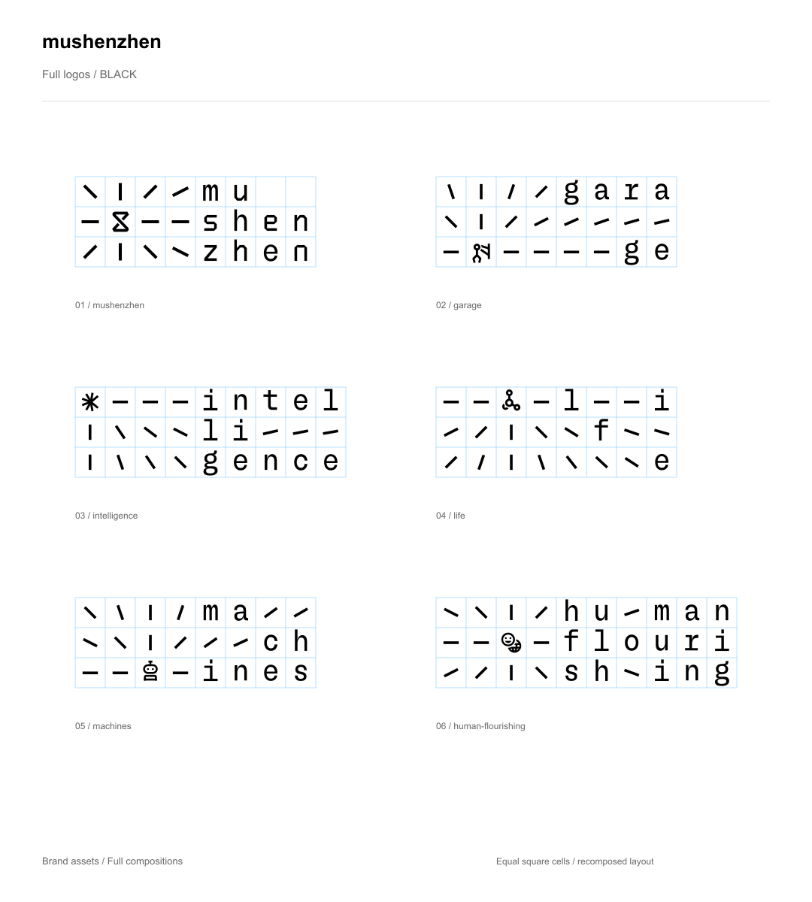

# mushenzhen

a city for makers

一座以整个深圳为实验田野的 Maker City。我们是连接。

这里提供 mushenzhen 的标准 Logo、视觉元素、品牌指南与 Agent 可读数据。视觉元素和模板允许商用，**使用时必须提到 mushenzhen**。例如：视觉素材来源：mushenzhen。完整说明见 [USAGE.md](USAGE.md)。

## 1. 下载素材

36 个透明底 Logo + 4 组视觉元素。完整版采用统一方格结构，简化版为横向字标。白色 SVG 请放在深色背景查看。

| 品牌 | 形式 | 黑色 | 白色 | 荧光绿 |
|---|---|---|---|---|
| mushenzhen | 完整版 | [black](assets/logos/full/mushenzhen-full-black.svg) | [white](assets/logos/full/mushenzhen-full-white.svg) | [green](assets/logos/full/mushenzhen-full-green.svg) |
| mushenzhen | 简化版 | [black](assets/logos/simple/mushenzhen-simple-black.svg) | [white](assets/logos/simple/mushenzhen-simple-white.svg) | [green](assets/logos/simple/mushenzhen-simple-green.svg) |
| garage | 完整版 | [black](assets/logos/full/garage-full-black.svg) | [white](assets/logos/full/garage-full-white.svg) | [green](assets/logos/full/garage-full-green.svg) |
| garage | 简化版 | [black](assets/logos/simple/garage-simple-black.svg) | [white](assets/logos/simple/garage-simple-white.svg) | [green](assets/logos/simple/garage-simple-green.svg) |
| intelligence | 完整版 | [black](assets/logos/full/intelligence-full-black.svg) | [white](assets/logos/full/intelligence-full-white.svg) | [green](assets/logos/full/intelligence-full-green.svg) |
| intelligence | 简化版 | [black](assets/logos/simple/intelligence-simple-black.svg) | [white](assets/logos/simple/intelligence-simple-white.svg) | [green](assets/logos/simple/intelligence-simple-green.svg) |
| life | 完整版 | [black](assets/logos/full/life-full-black.svg) | [white](assets/logos/full/life-full-white.svg) | [green](assets/logos/full/life-full-green.svg) |
| life | 简化版 | [black](assets/logos/simple/life-simple-black.svg) | [white](assets/logos/simple/life-simple-white.svg) | [green](assets/logos/simple/life-simple-green.svg) |
| machines | 完整版 | [black](assets/logos/full/machines-full-black.svg) | [white](assets/logos/full/machines-full-white.svg) | [green](assets/logos/full/machines-full-green.svg) |
| machines | 简化版 | [black](assets/logos/simple/machines-simple-black.svg) | [white](assets/logos/simple/machines-simple-white.svg) | [green](assets/logos/simple/machines-simple-green.svg) |
| human-flourishing | 完整版 | [black](assets/logos/full/human-flourishing-full-black.svg) | [white](assets/logos/full/human-flourishing-full-white.svg) | [green](assets/logos/full/human-flourishing-full-green.svg) |
| human-flourishing | 简化版 | [black](assets/logos/simple/human-flourishing-simple-black.svg) | [white](assets/logos/simple/human-flourishing-simple-white.svg) | [green](assets/logos/simple/human-flourishing-simple-green.svg) |

| 视觉元素 | SVG |
|---|---|
| 主视觉：斜线、沙漏、深、圳 | [下载](assets/elements/musz_main_kv.svg) |
| Machines：斜线、机器人、机、器 | [下载](assets/elements/musz_machines.svg) |
| Life：斜线、生命符号、生、命 | [下载](assets/elements/musz_life.svg) |
| Intelligence：斜线、星号、智、能 | [下载](assets/elements/musz_intelligence.svg) |

完整主视觉海报和可编辑运营模板暂未包含在此版本中。

## 2. 阅读规范

[品牌指南](GUIDE.md) · [品牌概念与语言](BRAND-STORY.md)

[简化版](examples/logo-simple-black.png) · [白色完整版](examples/logo-full-white.png) · [绿色完整版](examples/logo-full-green.png) · [白色简化版](examples/logo-simple-white.png) · [绿色简化版](examples/logo-simple-green.png)

[色板](examples/palette.png) · [字体样张](examples/typography.png) · [使用示例](examples/logo-usage.png)

## 3. 让 Agent 使用品牌资产

从 [AGENT-GUIDE.md](AGENT-GUIDE.md) 开始。

- [brand.json](brand.json)：名称、slogan、定位、路径与署名要求。
- [assets.json](assets.json)：文件路径、颜色、尺寸和 SHA-256。
- [colors.json](colors.json)：完整主题色板。
- [rules.json](rules.json)：已确认规则与使用建议。

## 4. 商用与署名

**视觉元素和模板允许商用，必须注明 mushenzhen。**可在作品页脚、随图发布文案或网页 credits 中署名；具体建议见 [使用说明](USAGE.md)。Logo 遵循品牌指南，不因使用素材而暗示官方背书。

本包不附带字体文件、照片或软件代码，不能将其授权推及这些内容。尚未指定标准公开许可证，使用要求以 USAGE.md 为准。

版本 0.1。年度活动安排不在本包中，请向主办方核对。
