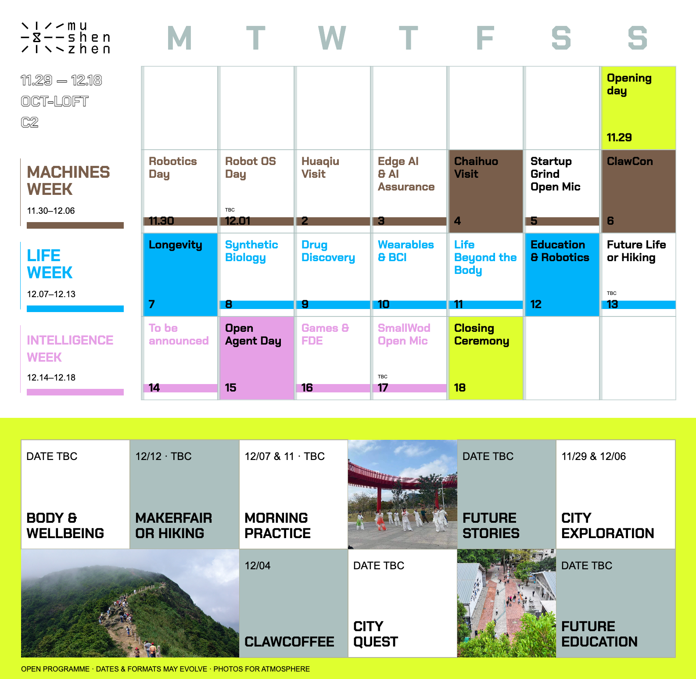

# muShenzhen Calendar · Agent Kit



仓库：https://github.com/superconcinnity/muShenzhen-Brand-Portal

下载这个目录，让你的 agent 先阅读 **AGENTS.md**。不需要编辑工具、不需要安装个人 skill，也不要求特定 agent 品牌。所有必要文件都在本目录。

## 给同事的用法

在仓库页面选择 **Code → Download ZIP** 后解压，或让 agent 执行：

```sh
git clone https://github.com/superconcinnity/muShenzhen-Brand-Portal.git
cd muShenzhen-Brand-Portal/templates/calendar
```

将下载目录作为 agent 工作目录，然后发一句：

> 读取 AGENTS.md，按现有设计把12月15日标题改成「Open Agent Day」，保留粉色重点日，检查排版并导出PNG和SVG。

更多例子见 [docs/PROMPTS.md](docs/PROMPTS.md)。第一次安装需要联网下载依赖及浏览器，后续本地渲染不联网；读取最新活动来源另需联网。

## 运行

需要 Node.js 20或更高版本。在本目录执行：

```sh
npm ci
npm run setup
npm run render
```

产物在 output/calendar.png、output/calendar.svg；SVG内嵌字体及图片。output/mobile-preview.png用于小屏预览，output/validation.json保存检查结果。也可以直接打开index.html预览，或用npm run check只运行检查。

## 文件

- AGENTS.md：给agent的任务流程和约束。
- content.js：短标题、重点日、状态、底部卡片及图片选择。
- calendar.js：固定设计模板。
- assets/：本地logo、字体、三张装饰图片。
- docs/DESIGN.md：设计规则。
- docs/full-schedule.json：精简前的每日内容参考，不自动同步。
- render.cjs：生成PNG/SVG，校验字体加载、标题宽度、固定字号及日期。
- package-lock.json：固定依赖，支持npm ci复现。

当前为2026.11.29–12.18这届活动模板；其他日期范围需同步修改网格逻辑，详情见AGENTS.md。依赖字体的SVG在某些设计软件中可能需要手动安装assets内字体；PNG不受影响。

## 分享与发布

本仓库公开提供团队协作模板，不包含Notion凭证、cookies或访问令牌，不包含自动发布逻辑。公开可下载不等于所有资产拥有开源授权：当前三张网络照片仅作版式示例，未核实再分发许可；对外使用请替换为自有或明确授权的照片。来源见docs/photo-credits.md，资产说明见docs/ASSETS.md。


## 后续协作

- 修改前同步仓库最新版本。编辑content.js后运行npm run render，查看output/calendar.png。
- 普通活动文案改days数组；重点日改对应项的true/false；底部文案改EXTRA_CARDS；图片改PHOTO_ASSETS。
- 日历标题固定26px，底部标题固定32px。超长时提炼短标题或换行，不缩小单格字号。
- 若需要更新仓库首页预览，将output/calendar.png复制为preview.png。只有用户要求时才提交和推送。
- 不会自动后台同步Notion／飞书；每次用自然语言让agent读取最新来源并更新。

## 常见问题

**标题太长导致检查失败？** 精简content.js中的短标题或用\n换行，不要降低字号、改检查阈值。

**提示缺少浏览器？** 运行npm run setup。Linux若缺少系统依赖，可由环境管理员安装，或运行npx playwright install --with-deps chromium。

**改日期范围后检查失败？** 这是固定活动版式，需要同步调整calendar.js的网格、主题周标签、页眉及render.cjs的日期校验。

**同事能下载但不能推送？** 公开仓库任何人可读取；写入原仓库需协作者权限，也可fork后通过PR提交。


视觉素材来源：mushenzhen。模板遵循仓库根目录的[使用要求](../../USAGE.md)，字体与第三方照片按各自的授权说明处理。
