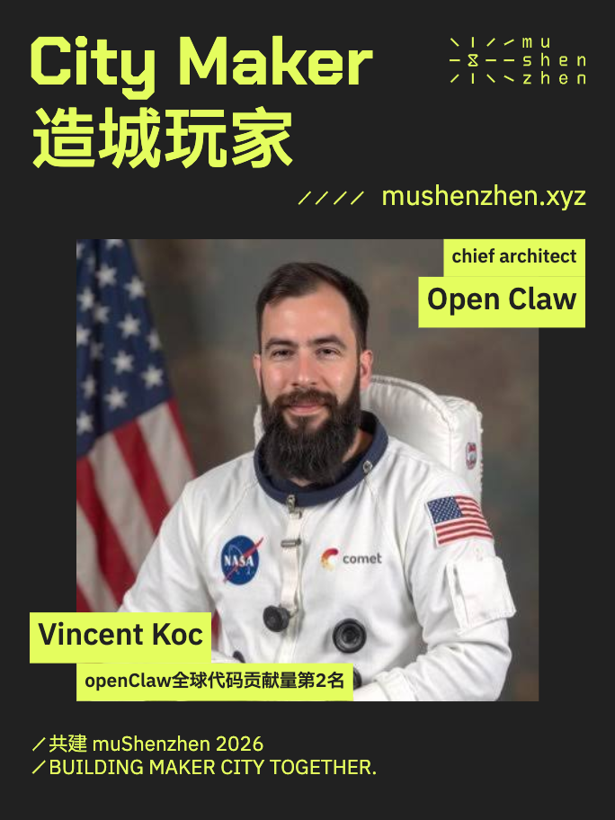

# City Maker 人物海报模板

已确认的 v4 版：公司／项目与姓名 64px，角色与中文描述 40px。支持自然语言指挥 Agent 更换人物信息、运行校验并导出，不需要另做编辑工具。



## 给同事的 Agent

复制下面这段，并附人物照片和资料：

> 从 https://github.com/superconcinnity/muShenzhen-Brand-Portal 下载仓库，阅读 templates/city-maker/AGENTS.md 和 README.md。使用这个已定稿的 City Maker 模板，替换人物照片、公司／项目、角色、姓名和中文一句话描述，保持品牌排版。不要缩字号、拉伸 logo 或让角色换行。运行完整导出与安全边距检查，交付 PNG、SVG、HTML 和预览。

自然语言示例见 [PROMPTS.md](PROMPTS.md)。照片与人物事实由使用者提供；如果明确要求查资料，可核对公开来源，不编造身份或活动参与关系。

## 下载和首次运行

需要 Node.js 20.9+ 和 npm。首次安装需要联网下载依赖和浏览器。

```sh
git clone https://github.com/superconcinnity/muShenzhen-Brand-Portal.git
cd muShenzhen-Brand-Portal/templates/city-maker
npm ci
npm run setup
npm run check
npm run render
```

`npm run setup` 安装 Playwright Chromium。Linux 若缺浏览器系统依赖，可运行 `npx playwright install --with-deps chromium`。已安装 Chrome 的电脑也可通过 `CHROME_PATH` 指定浏览器可执行文件，例如 macOS：

```sh
CHROME_PATH="/Applications/Google Chrome.app/Contents/MacOS/Google Chrome" npm run render
```

## 每次更换人物

1. 将干净照片放进 `assets/`，支持 PNG、JPEG、WebP；建议至少 1200px，近方形、面部居中，避免截图或带字照片。
2. 修改 `content.json` 中以下五项；照片路径相对本模板根目录。
3. 运行 `npm run check` 和 `npm run render`。
4. 查看 `output/preview.png`，确认面部没有被裁掉或被标签挡住。不要只看程序成功提示。

| 字段 | 内容 | 字符范围 |
| --- | --- | --- |
| `portrait` | 照片路径，如 assets/person.jpg | 必填 |
| `company` | 公司／项目英文名 | 2–18 |
| `role` | 项目角色，英文 | 2–24 |
| `name` | 中文、英文或中英双语姓名 | 2–24 |
| `description` | 中文一句话描述，可含英文项目名 | 8–24 |

计数去掉首尾空格，每个字母、汉字、标点及内部空格都算一个字符。上述范围是当前模板的编辑约束，不是品牌全局标准。姓名须保留真实拼写；超限时先与使用者确认简称或模板调整，不自行改名。

## 导出文件

- `output/poster.png`：2631 × 3509 PNG。
- `output/poster.svg`：内嵌字体、照片、logo 的独立 SVG。
- `index.html`：可直接打开的浏览器预览。
- `output/preview.png`：684 × 912 小图。
- `output/layout.json`：每个标签的位置、尺寸及行数。

不同设计软件对 SVG 内嵌字体的支持不同；以浏览器和 PNG 为准。PNG 导出后会检查可见像素是否越过安全区。任何命令报错后，已有输出可能是旧版或未通过检查的中间文件，不应交付。

### 多人批量生成

复制 content.json 为不同人物 JSON，保留固定品牌字段；从本模板目录执行：

```sh
node render.cjs people/alice.json output/alice
node render.cjs people/bob.json output/bob
```

指定输出目录时 HTML 也写入该目录，不覆盖默认 Vincent 输出。JSON 和输出目录参数相对当前工作目录；JSON 中的照片路径始终相对模板根目录。需要对批量配置做完整检查时直接运行上述导出命令，`npm run check` 单独检查默认 content.json。

## 已确认视觉规则

详细规则见 [AGENTS.md](AGENTS.md)，机器可读参数见 [template-rules.json](template-rules.json)。

- 固定主标题、logo、网址与底部两行；保留示例中已经确认的大小写及年份，除非使用者要求更改。
- 公司／项目和姓名：64；角色和中文描述：40。单位基于 1368 × 1824 布局坐标。
- 标签背景按文字实际测量，内边距 18，行高 1.2 倍。
- 右上角色在上、公司在下，右对齐、零间距。角色必须单行，可向左延长至安全边界，不缩字。
- 姓名和介绍左侧错位排列，零间距，整体底部对齐照片底部。
- 角色之外的标签最多两行；公司／项目最大宽448、姓名650、描述1028。角色最大宽1236。
- 安全区 x=66–1302、y=80–1730；这是内容安全边距，不是印刷裁切出血。背景铺满画布，辅助线不出现在成品中。
- logo 使用 Portal 标准矢量，等比显示，按实际图形对齐大写字母上下缘，右对齐安全线。只排除透明画布留白，不修改路径或内部格距。
- 网址与底部文字使用 Regular 400。网址连同斜线整体下移20，网址可见右端对齐安全线。

## 字体与素材

- Chakra Petch Bold：主标题。
- IBM Plex Sans SC SemiBold：中文主标题及人物标签。
- IBM Plex Sans SC Regular：网址和页脚。
- 背景 #212121；本模板强调色 #E4FD5E。这是用户确认的模板颜色，不改写 Portal 全局默认绿。
- 字体随包提供，SIL OFL 许可见 assets；Plex-SemiBold.otf 是为浏览器兼容性去除子程序的版本，保留字体信息。
- logo 来源：Portal 的 assets/logos/full/mushenzhen-full-green.svg，对应本模板颜色替换。
- Vincent 照片为模板委托者提供的示例。品牌视觉授权不自动覆盖人物肖像与照片；正式发布请使用获准使用的素材。网上测试人物照片未收入本目录。

视觉素材来源：mushenzhen。遵循仓库 [USAGE.md](../../USAGE.md)，不额外声明 MIT 等代码许可。
