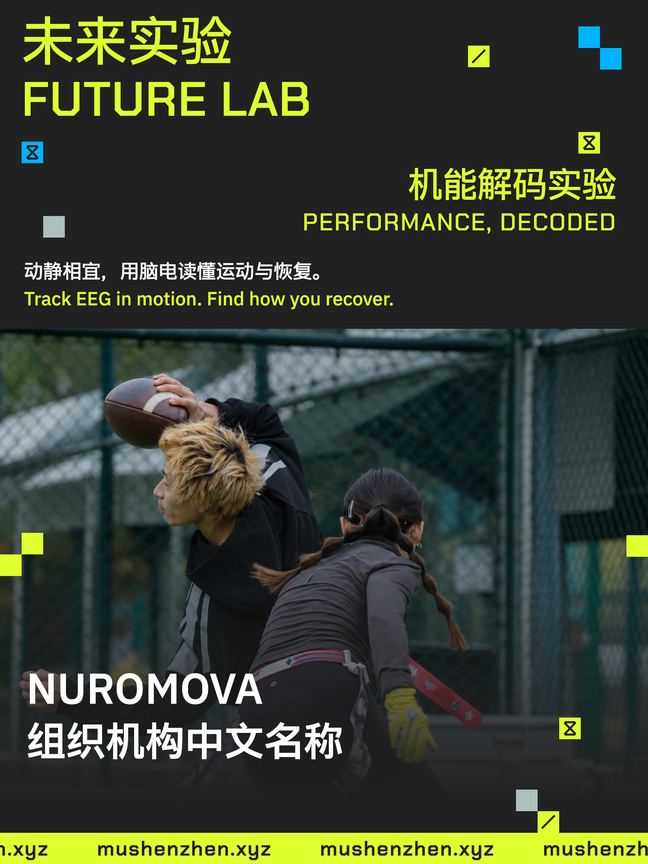

# 未来实验 / FUTURE LAB 模板

下载后让 Agent 用独立配置替换视觉图、活动名称、介绍和组织机构名称，生成参考版式的活动海报。固定“未来实验 / FUTURE LAB”、品牌装饰和底部网址色带，忽略参考图照片右上角的Logo。

[Agent 规则](AGENTS.md) · [版式规则](RULES.md) · [指令示例](PROMPTS.md) · [素材说明](ASSETS.md)



## 下载与运行

```sh
git clone https://github.com/superconcinnity/muShenzhen-Brand-Portal.git
cd muShenzhen-Brand-Portal/templates/future-lab
npm ci
npm run setup
npm run render
```

需要 Node.js 20.9+、npm。首次下载依赖及 Chromium 需要联网。如果浏览器下载较慢，可直接指定本机 Chrome，例如 macOS：

```sh
CHROME_PATH="/Applications/Google Chrome.app/Contents/MacOS/Google Chrome" npm run render
```

默认输出在 `output/content/`。画布1080 × 1440，PNG默认以2倍尺寸2160 × 2880导出。

## 替换内容

复制 `content-template.json` 为新配置，把原图放在 `assets/`，再填写：

| 字段 | 内容 |
| --- | --- |
| image.src | 相对此模板目录的图片路径 |
| image.position | center、top、bottom、left、right；默认center |
| event.zh / en | 活动名称中文 / 英文，对应右上绿色标题 |
| description.zh / en | 一句话介绍中文 / 英文，对应照片上方介绍 |
| organizer.zh / en | 活动组织机构中文 / 英文名称，对应照片上的白字，英文在上、中文在下 |
| metadata | 可选来源或备注对象，不显示在海报上 |

业务内容只有7项：活动中英文名称、一句话中英文介绍、视觉图、组织机构中英文名称。image.position是可选裁切设置，metadata是可选制作记录，均不增加文案必填项。原账号、标签、第二组项目标题不再作为输入。

```sh
node render.cjs my-event.json exports/my-event
```

图片路径相对此模板目录，配置和输出路径相对当前终端目录；含空格的命令参数需加引号。独立导出不覆盖默认配置。

活动名称显示在右上绿色标题区；组织机构名称显示在照片白字区。所有文案保持固定字号与单行。超宽、碰到装饰或字段拼写错误会报错；先提炼关键内容，再重新导出。不能靠缩字或强制换行掩盖溢出。

照片等比cover填满图片区，上方保留清晰主体，下方逐渐融入深色背景。要检查人物头部、手部或产品有没有被裁切；位置不合适时调整position或更换余量更足的原图。导出像素数不等于原图清晰度。

## 交付文件

- `poster.png`：高清成品；`preview.png`：快速预览。
- `grid-proof.png` / `grid-preview.png`：带辅助网格的检查图。
- `poster.html`：嵌入照片、字体和脚本的独立预览，可复制到其他目录打开。
- `content.json`：本次配置；`validation.json`：字体、文字范围、装饰碰撞及图片提示。
- `render-status.json`：本次运行时间及状态。只有命令成功、状态为passed时才交付，失败时不可使用目录内的旧PNG。

默认渲染还会更新模板根目录的 `data.js`；之后打开 `index.html` 可查看本地预览和辅助网格。改JSON后需重新渲染，直接刷新HTML不会重新读取配置。

HTML/CSS/JSON是可编辑源，本模板输出PNG和HTML，不提供完整可编辑SVG海报。默认示例照片由用户参考图经AI清理叠字和Logo得到，用于展示版式；正式制作优先提供独立原始照片。图片处理不用于新增或更改活动事实。默认机构英文名沿用参考图，中文名为占位文字，正式制作需填写准确名称。

品牌素材及字体使用条件见[ASSETS.md](ASSETS.md)和仓库[USAGE.md](../../USAGE.md)。随作品说明注明“视觉素材来源：mushenzhen”。
