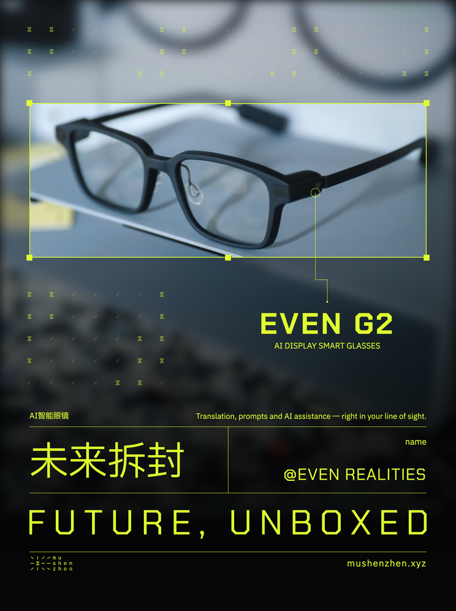

# Future, Unboxed 产品海报模板

用于替换产品图片、名称、品类、介绍和品牌署名。保持已确认的品牌字体、颜色、网格、高亮窗口、引导线和背景装饰规则。

[Agent 执行规则](AGENTS.md) · [完整设计与适配规则](RULES.md) · [自然语言指令示例](PROMPTS.md) · [素材说明](ASSETS.md)



## 下载与首次运行

环境：Node.js 20.9+（推荐当前受支持的 LTS）、npm。macOS、Linux、Windows 可使用 Playwright Chromium。首次需要网络下载依赖和浏览器。

```sh
git clone https://github.com/superconcinnity/muShenzhen-Brand-Portal.git
cd muShenzhen-Brand-Portal/templates/future-unboxed
npm ci
npm run setup
npm run render
```

Linux 缺少浏览器系统库时，按 Playwright 的报错安装依赖：`npx playwright install --with-deps chromium`。也可通过 `CHROME_PATH` 环境变量指定已有 Chrome 可执行文件。

输出位于 `output/`：

- `poster.png`：2480 × 3320 高清成品。
- `poster-preview.png`：预览。
- `grid-proof.png`、`grid-proof-preview.png`：网格检查图。
- `validation.json`：字体、溢出、网格、高亮框、安全区及引导线检查结果。

渲染后可在浏览器打开 `index.html` 查看主样例，按钮切换辅助网格。修改 JSON 后需重新渲染，直接刷新 HTML 不会自动读取 JSON。

## 换图和文案

先读 [RULES.md](RULES.md)，查看原图，再复制 `content.json` 为独立配置（例如 `my-product.json`）。图片放入 `assets/`，配置使用相对此模板目录的路径。

| 字段 | 内容 |
| --- | --- |
| product | 产品名称 |
| subtitle | 英文品类 |
| category | 中文品类 |
| description | 一句英文介绍 |
| company | 品牌 / 项目 / 个人署名 |
| image.src | 原始图片相对路径 |
| image.placement | 全图位置及等比尺寸 |
| image.target | 原图中归一化的完整产品范围；可包含必要上下文 |
| image.anchor | 高亮窗口内引导线起点，0–1 |
| decoration.foregroundPolygons | 原图归一化前景轮廓，包括人物、手部、附件 |

```sh
node render.cjs my-product.json exports/my-product
```

独立导出不会覆盖默认配置或默认 `data.js`。输出目录内的 HTML 引用本模板的相对资源，单独发送该 HTML 不足以复现；需同时提供模板、配置与图片。分享成品可直接发送 PNG。

正文规则摘要：顶部安全线80px，含角点后框上沿≥100px；框底到引导线横段≥60px、末段60px、距标题组20px。长产品名可用 `productLayout: {"column":3,"span":4}` 扩为4列，字号不变。图片主体比例、前景标定及最终视觉效果仍需看图判断，不是自动识别。

保持固定 logo、网址、“未来拆封 / FUTURE, UNBOXED”、品牌绿和字号层级。随作品说明注明“视觉素材来源：mushenzhen”。

## 多种构图示例与回归检查

默认眼镜展示图由用户提供。`tests/` 附三品牌四份配置：Nothing 纯产品 / 人物佩戴、rabbit 手持设备、teenage engineering 透明底单品。第三方原图不随库分发，来源见 [sources](tests/surround-batch-sources.json)。

需要复现这些测试时显式运行：

```sh
npm run test:assets
npm run test:render
npm run test:decorations
```

下载脚本只按已保存的官方 URL 下载已列出的四张原图，不登录、不搜索、不上传。远程素材下线时应检查来源并更新标定，不要随意替图沿用旧轮廓。下载内容与测试输出被 Git 忽略；不代表正式合作或可商用照片授权。

每张测试的 PNG、网格图和验证结果位于 `tests/<样例名>/`。装饰检查只验证已标定轮廓，不能证明标定准确；所有海报仍需视觉验收。

## 文件结构

- `AGENTS.md`：同事的 agent 应先读。
- `RULES.md`：完整适配规则与能力边界。
- `content.json`：默认配置；`grid.json`：统一布局与间距。
- `app.js` / `style.css` / `index.html`：前端模板。
- `render.cjs`：布局计算、验证及 PNG 导出。
- `assets/`：官方矢量、字体、许可和用户提供的默认照片。
- `tests/`：可选官方素材测试配置及脚本。

代码与品牌素材使用条件见仓库 [USAGE.md](../../USAGE.md)。字体按随附 SIL OFL 许可；照片不自动适用品牌素材授权。
