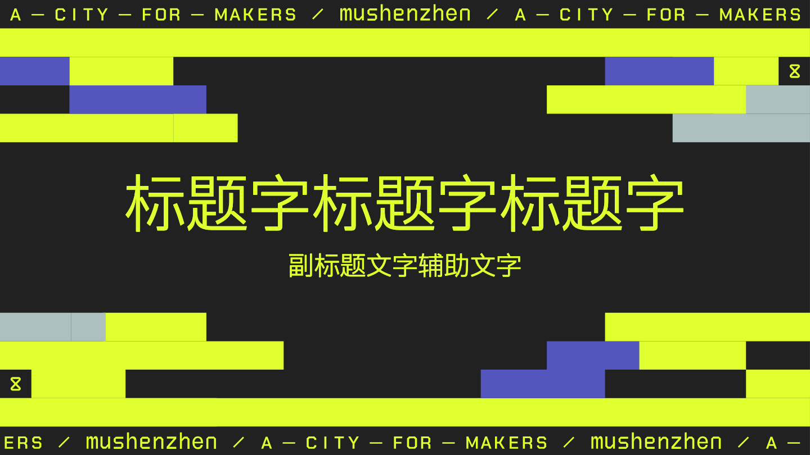
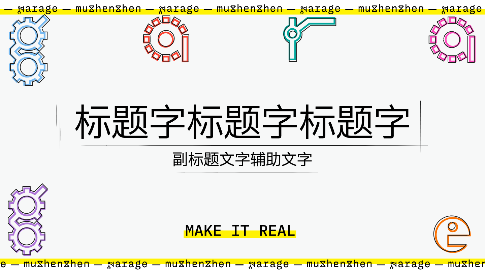
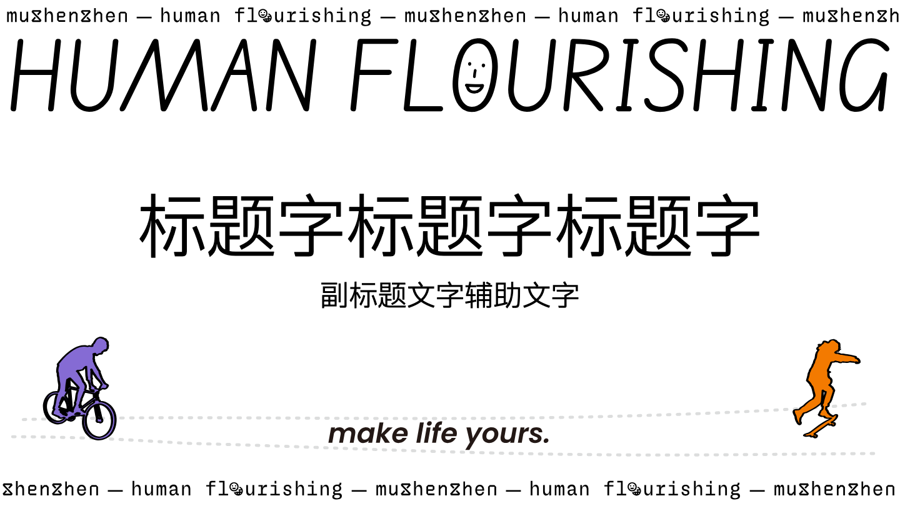

# 品牌演示模板

三套品牌独立分类。PPT 中标题和正文可编辑，固定品牌图形使用高清底图。HTML 保留 SVG 矢量底图。

## muShenzhen

10 个版式。

[在线预览](https://superconcinnity.github.io/muShenzhen-Brand-Portal/templates/presentations/mushenzhen/) · [下载 PPTX](downloads/mushenzhen.pptx?raw=true) · [下载 HTML / Agent 模板包](downloads/mushenzhen-html-agent.zip?raw=true)

## Garage

2 个版式。

[在线预览](https://superconcinnity.github.io/muShenzhen-Brand-Portal/templates/presentations/garage/) · [下载 PPTX](downloads/garage.pptx?raw=true) · [下载 HTML / Agent 模板包](downloads/garage-html-agent.zip?raw=true)

## Human Flourishing

3 个版式。

[在线预览](https://superconcinnity.github.io/muShenzhen-Brand-Portal/templates/presentations/human-flourishing/) · [下载 PPTX](downloads/human-flourishing.pptx?raw=true) · [下载 HTML / Agent 模板包](downloads/human-flourishing-html-agent.zip?raw=true)

## 使用

下载并解压模板包，打开品牌目录的 index.html。文字修改后保存的 HTML 请留在该目录，与 assets 和 fonts 一起转发。Agent 先读取 AGENTS.md，再读取所选品牌的 template.json。安装包内字体可减少 PPT 在不同电脑上的字体替换。

视觉素材来源：mushenzhen。使用要求见 [USAGE.md](../../USAGE.md)。
