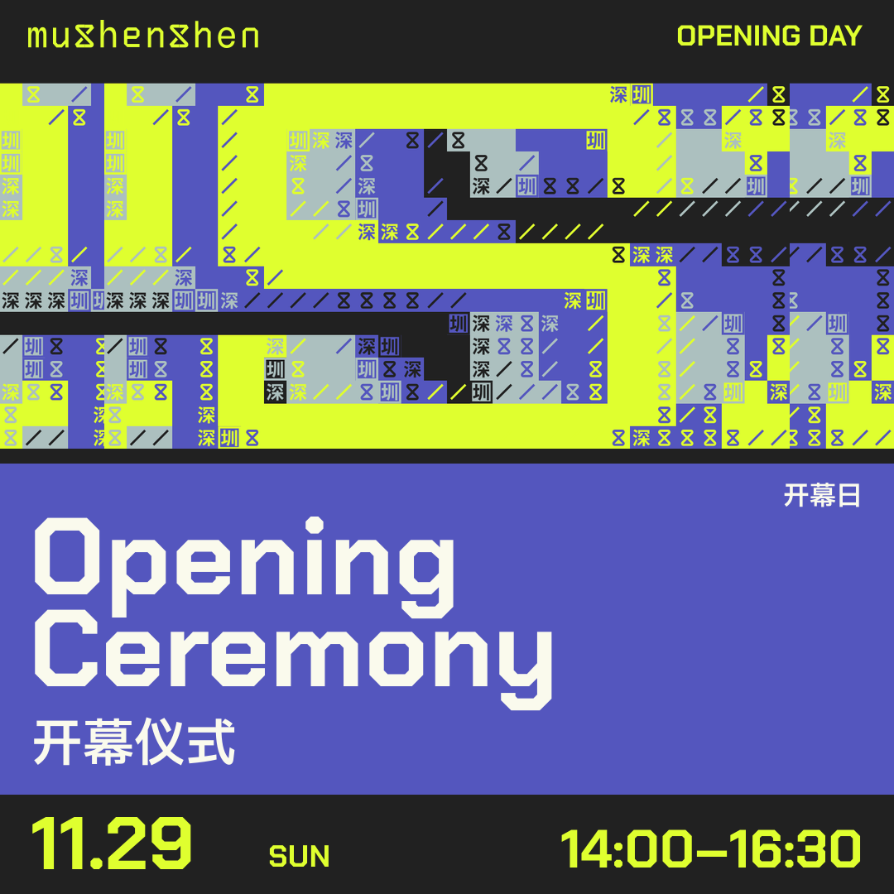
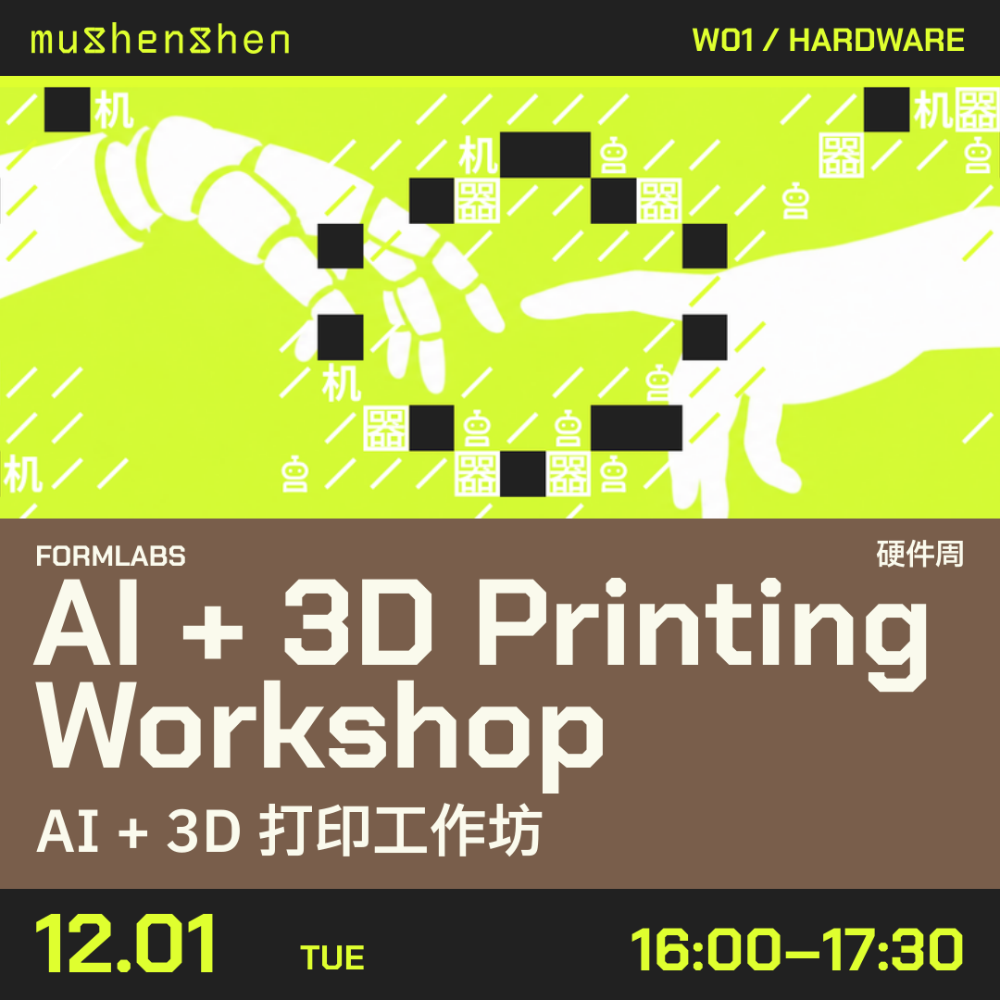
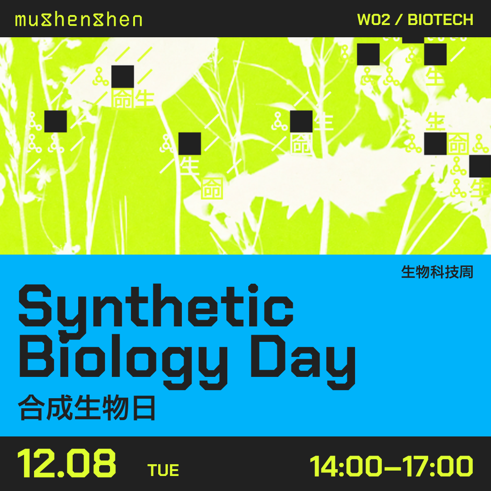

# muShenzhen · Social Layer 活动封面 V3

让 Agent 制作新封面时，把[制作说明](AGENTS.md)与本场活动资料发给它。也可以直接下载下表中的 SVG，安装[随包字体](assets/fonts/)，在 Illustrator 或 Inkscape 中编辑。每张封面为 1080 × 1080，配图已嵌入，标题、日期、星期和时段可分别编辑。

<p><a href="examples/SVG/opening.svg"></a><a href="examples/SVG/hardware.svg"></a><a href="examples/SVG/biotech.svg"></a><a href="examples/SVG/ai.svg"></a></p>

| 活动单元 | 配置 | 默认配图 | 可编辑母版 | PNG 样张 |
| --- | --- | --- | --- | --- |
| 开幕日 | `main` | 开幕仪式用完整的小 S。普通开幕日活动用主视觉下半部分 | [SVG](examples/SVG/opening.svg) | [PNG](examples/PNG/opening.png) |
| 硬件周 | `machines` | 机械手 | [SVG](examples/SVG/hardware.svg) | [PNG](examples/PNG/hardware.png) |
| 生物科技周 | `life` | 植物 | [SVG](examples/SVG/biotech.svg) | [PNG](examples/PNG/biotech.png) |
| AI 周 | `intelligence` | 电路板 | [SVG](examples/SVG/ai.svg) | [PNG](examples/PNG/ai.png) |

四张母版取自已确认的 V3 定稿，分别为开幕仪式、AI + 3D 打印工作坊、合成生物日和 AI 与游戏日。新活动的名称、图片和时间由主办方提供。

## 制作一张

下载本目录，进入目录后运行。需要 Python 3.9+。原版导出工具为 HarfBuzz 的 `hb-view` 和 librsvg 的 `rsvg-convert`。macOS 可用 `brew install harfbuzz librsvg`，Debian / Ubuntu 可用 `apt install libharfbuzz-bin librsvg2-bin`。也支持安装了 Inkscape CLI 与 Python Pillow 的环境。脚本直接读取随包字体。

```sh
cp content-template.json my-event.json
# 把 my-event.json 改成本场活动资料
python3 render.py my-event.json --out output
```

输出位于 `output/PNG/<key>.png` 和 `output/SVG/<key>.svg`。相同 key 会更新对应成品。可将多个活动放进同一个 JSON 数组。要重做四套样张，运行 `python3 render.py examples/contents.json --out preview`。

## 字段与配图

| 字段 | 填写方法 |
| --- | --- |
| `key` | 唯一文件名，支持字母、数字、下划线和连字符。 |
| `theme`、`ceremony` | 主题选上表四值之一。只有开幕仪式使用 `"theme": "main", "ceremony": true`。 |
| `full_title`、`title_en`、`title_zh` | 完整活动名保存在 SVG 中。英文展示标题是包含一至两行的数组，每项一行。中文展示标题可选。 |
| `session` | 可选的机构、场次或额外付费提示。 |
| `start`、`end` | 带时区的 ISO 8601 时间，如 `2026-12-01T16:00:00+08:00`，渲染时统一转为深圳时间。页脚使用开始日期；跨日活动另注明结束日期。 |
| `image` | 可选，填写相对本场 JSON 的 JPEG 或 PNG 路径。省略时采用本周默认图窗。 |
| `image_fit`、`image_background` | 横图默认用 `slice` 居中铺满。方形插画用 `meet` 完整展示，留边底色可写六位十六进制色值。 |

例如将自有照片放在配置旁的 `photos/robot.jpg`，再给 JSON 加上 `"image": "photos/robot.jpg"`。方形插画可另加 `"image_fit": "meet", "image_background": "#FAFAED"`。图窗为 1080 × 478，从 y=82 起。

原 V3 工具链为 HarfBuzz 15.1.0、librsvg 2.63.4、Cairo 1.18.6。不同版本或 Inkscape 后备导出的字宽取整、抗锯齿及 PNG 编码可能有细微差异。各主题配色和原始图窗见 [themes.json](themes.json) 和 [assets/art](assets/art/)。

视觉素材来源：mushenzhen。随包字体 Chakra Petch Bold 与 IBM Plex Sans SC SemiBold 各附 SIL OFL 许可。品牌素材使用要求见 [USAGE.md](../../USAGE.md)。
