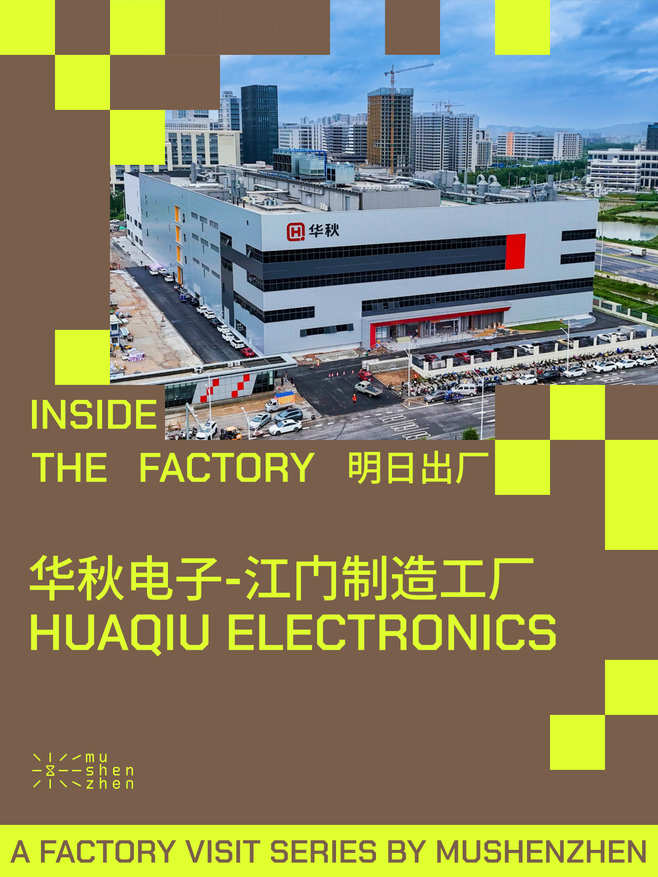

# 明日出厂 / INSIDE THE FACTORY 模板

让同事的 Agent 下载本目录，替换工厂照片、工厂中文标题和英文标题，按两种配色出图。无需使用网页编辑器。

[Agent 规则](AGENTS.md) · [版式规则](RULES.md) · [自然语言指令](PROMPTS.md) · [素材说明](ASSETS.md)



## 下载与导出

```sh
git clone https://github.com/superconcinnity/muShenzhen-Brand-Portal.git
cd muShenzhen-Brand-Portal/templates/tomorrow-factory
npm ci
npm run setup
npm run render
npm run render:blue
```

需要 Node.js 20.9+、npm。首次安装依赖和 Chromium 需要联网；也可设置 `CHROME_PATH` 为本机 Chrome 可执行文件路径。Linux 缺系统库时按 Playwright 的报错安装依赖。

默认棕色导出到 `output/content/`，蓝色导出到 `output/blue/`。每份输出包括 2632 × 3509 的 `poster.png`、嵌入图片与字体的 `poster.svg`、`poster.html`、`preview.png`、本次配置和 `validation.json`。

## 替换内容

复制 `content.json` 为独立配置，例如 `my-factory.json`，把原图放进本模板 `assets/`：

```json
{
  "theme": "brown",
  "image": { "src": "assets/my-photo.jpg", "position": "centre" },
  "titleZh": "工厂中文名称",
  "titleEn": "FACTORY NAME"
}
```

```sh
node render.cjs my-factory.json exports/my-factory
```

`image.src` 相对此模板目录；配置和输出目录参数相对当前终端目录。配色仅选 `brown` 或 `blue`。照片等比填满原稿照片区域，保留原有像素遮罩；默认居中裁切，可调整 `position` 为 top、bottom、left、right、attention、entropy。

替换的是下方“华秋电子-江门制造工厂 / HUAQIU ELECTRONICS”。“明日出厂 / INSIDE THE FACTORY”、Logo、底部系列说明、色块与画布比例固定。

默认标题保留原稿轮廓，完全沿用原字形；更换文字时使用包内 IBM Plex Sans SC Regular / Chakra Petch Regular 200px。标题单行，超宽会报错；先精简真实文案，不通过压缩字宽掩盖溢出。

照片和标题替换后，Agent 应打开 PNG 预览检查工厂主体、原稿色块遮挡、标题可读性。程序通过不能代替看图。失败时不要交付旧成品。

## 文件

- `content.json` / `content-blue.json`：两套默认配置。
- `render.cjs`：配置驱动的 SVG / PNG 导出。
- `assets/template.svg`：由设计稿提取的完整矢量版式，保留原遮罩和固定轮廓；照片由脚本注入。
- `assets/factory-photo.png`：两份原稿共有的内嵌照片，只存一份。
- `assets/`：字体及原许可。
- `examples/`：两种配色预览。

署名与使用条件遵循仓库 [USAGE.md](../../USAGE.md)。照片不自动适用品牌素材授权。原始设计由用户提供，本模板没有附网上搜索的测试照片。
